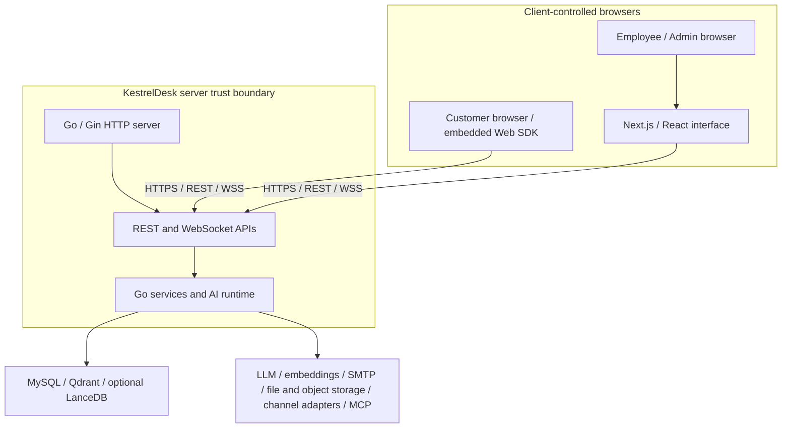
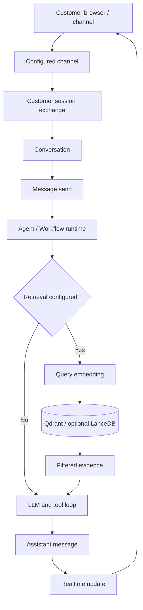
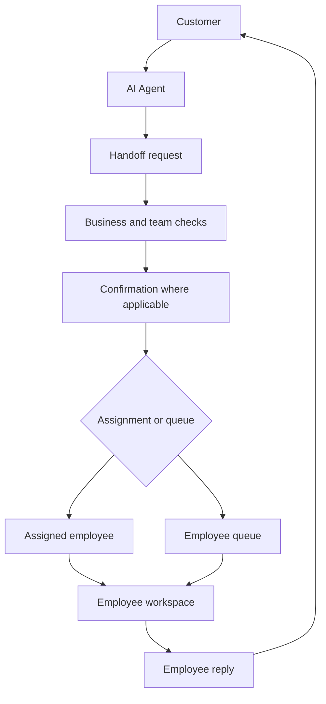
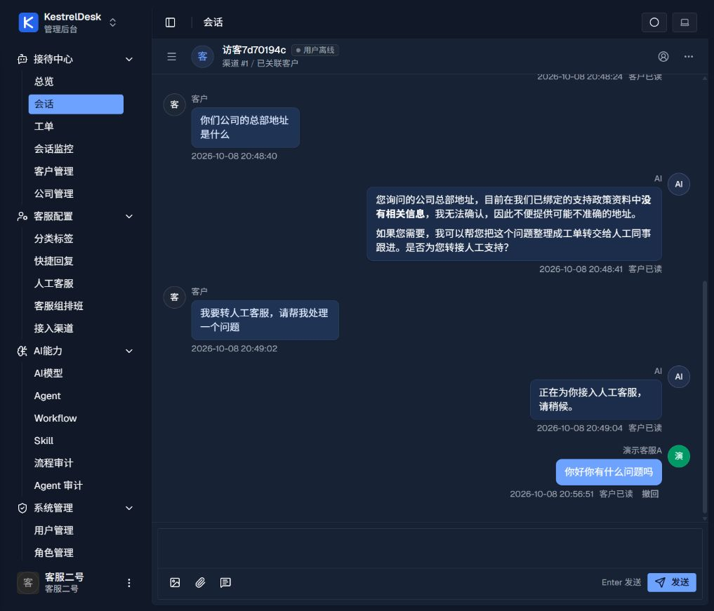
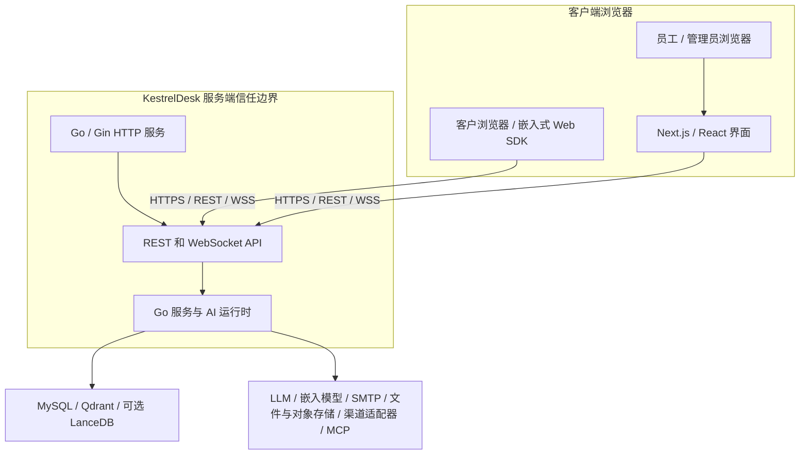
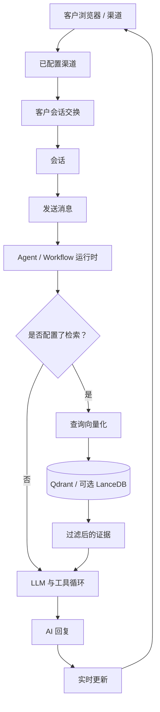
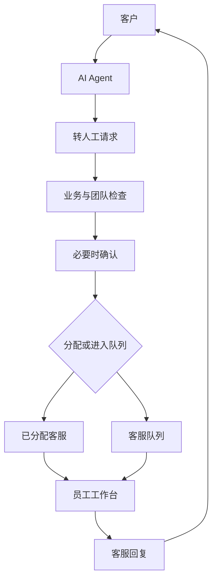

[English](#kestreldesk) | [简体中文](#简体中文)

# KestrelDesk

**Self-hosted AI Customer Support & Realtime Collaboration Platform**

AI-assisted customer conversations, knowledge retrieval, a human-agent workspace, ticketing, configurable AI workflows, and channel integrations in a self-hosted Go application.

[](https://go.dev/)
[](https://nextjs.org/)
[](https://react.dev/)
[](https://docs.docker.com/compose/)
[](#deployment)
[](LICENSE)

KestrelDesk brings customer-facing support surfaces and employee operations into one application. It combines live conversations with AI-assisted replies, a knowledge/RAG pipeline, ticket and customer records, and configurable Agent and Workflow execution. Operators deploy it on their own infrastructure and configure their own model providers, channels, and email service.

- [Product capabilities](#product-capabilities)
- [Architecture](#architecture)
- [Quick start](#quick-start)
- [Configuration](#configuration-overview)
- [Known limitations](#known-limitations)
- [简体中文](#简体中文)

## Product capabilities

### AI customer support

- Customer conversations can use configured chat-model providers and Agents.
- Chat and embedding providers are configured by the operator; provider credentials and model weights are not bundled.
- Agents support revisions, publishing, rollback, and run inspection.
- AI quality depends on the selected models, instructions, tools, and configured data.

### Knowledge and retrieval

- Manage knowledge bases, documents, FAQs, chunks, and embeddings.
- Use Qdrant in the default Compose setup; optional LanceDB Compose profiles are available.
- Bind knowledge bases to Agents and inspect retrieval records. Retrieval filters can constrain eligible knowledge and documents.
- Retrieval is conditional on the selected Agent or Workflow configuration. Retrieved evidence does not guarantee a correct answer.

### Realtime agent workspace

- Work with the conversation queue, claim and assign conversations, dispatch or transfer work, and reply to customers.
- View read state and agent presence; configure teams, schedules, quick replies, and notifications.
- Server-side authorization is applied to employee actions and realtime delivery.

### Ticket management

- Create and assign tickets, including from conversations; link customers and manage status, progress, and labels.
- Ticket concurrent-write conflict semantics are not yet defined as a single product contract.

### AI orchestration

- Configure Agents, revisions, publishing, rollback, and Agent Runs.
- Author versioned Workflows, publish versions, and inspect Workflow Runs.
- Configure Skills and MCP servers/tools for runtime use. Skills are not advertised as arbitrary-code sandboxes.

### Customer and CRM records

- Manage customers, companies, contacts, tags, and external identity mappings.
- These customer records are support-oriented; KestrelDesk is not a full marketing CRM.

### Channels and integrations

| Surface | Status | Notes |
| --- | --- | --- |
| Web chat / embedded Web SDK | Implemented | Configure the channel and allowed browser origins for the deployment. |
| Email / SMTP delivery | Configuration required | SMTP is configured per deployment; this is not a claim of a complete hosted email service. |
| WeCom / WxWork | Limited | Callback timing remains a known limitation. |
| Telegram, Slack, Discord, Lark, Zalo | Adapter available | Configure provider credentials and validate the integration in the target environment. Adapter presence alone does not claim a complete production setup. |
| MCP | Implemented | Configure the MCP servers and tools used by the deployment. |

### Support Center

The public support surface includes a support home, documentation, community pages, posts and interactions, customer sign-in/profile pages, and online consultation. Administrators can configure support content and navigation and moderate community content. The public entry is `/support`.

### Authentication and security design

- Customer identity and employee identity use separate authentication and authorization paths.
- Employee permissions and team/global scopes are checked server-side.
- Persistent employee login sessions can be revoked; WebSocket access is bound to the authenticated session and revalidated for protected delivery.
- Passwords are hashed with bcrypt. Password recovery uses anti-enumeration behavior and hashed reset tokens.
- Fresh operator bootstrap fails closed when the required bootstrap password is missing. Local operators can use the CLI password-recovery command; it is not a remote recovery endpoint.
- Browser origins are controlled by CORS configuration; selected endpoints use rate limiting. SMTP secrets and provider errors are sanitized at application boundaries.

These are implementation details, not a security certification or an independent audit. See [Security](SECURITY.md), [guest identity](docs/engineering/guest-identity-security.md), [realtime authorization](docs/engineering/realtime-authorization.md), and [WebSocket lifecycle](docs/engineering/websocket-lifecycle.md).

## Architecture

The browser is an untrusted client. The Go server verifies customer proof, employee sessions, permissions, and realtime authorization before services access application data or emit protected events. The bundled Next.js/React interface and embedded Web SDK call the Go application over HTTP and WebSocket APIs.



The default Compose deployment uses KestrelDesk, MySQL, and Qdrant. LanceDB is optional. Operators provide external model, email, channel, and storage configuration as needed. See [the architecture notes](docs/engineering/architecture.md) for the code map and trust boundaries.

### AI and RAG request flow



Retrieval is conditional on Agent/Workflow configuration. A configured path can embed the query, search the selected vector store, pass eligible evidence into the model/tool loop, persist the message, and send a realtime update. See [RAG and Answerability](docs/engineering/rag-pipeline.md).

### Human handoff



The end-to-end human handoff experience remains **partially validated**. This diagram describes the intended implemented path; it does not claim that every dispatch, capacity, routing, or lifecycle case is fully validated.

## Screenshots

The current gallery contains the existing synthetic employee-workspace capture. More clean captures are tracked in the [screenshot manifest](docs/screenshots/README.md); no real customer records or browser session data are used.

<table>
  <tr>
    <td width="50%" align="center">
      <a href="screenshots/kestreldesk/employee-workspace.jpg"></a>
    </td>
    <td width="50%">
      <strong>Employee conversation workspace</strong><br>
      Synthetic local conversation showing the agent workspace and reply view.<br><br>
      <a href="docs/screenshots/README.md">See planned screenshot coverage</a>
    </td>
  </tr>
</table>

## Technology stack

| Area | Technology |
| --- | --- |
| Backend | Go 1.26.0, Gin 1.12.0, GORM 1.31.2 |
| AI runtime | Cloudwego Eino 0.9.6; OpenAI-compatible model integration |
| Frontend | Next.js 16.2.11, React 19.2.3, TypeScript 6.0.3 |
| Workflow editor | Flowgram 1.0.12 |
| Relational database | MySQL 8.4 in the default Compose setup |
| Vector storage | Qdrant by default; optional LanceDB profiles |
| Realtime | Gorilla WebSocket 1.5.3 |
| Authentication primitives | bcrypt and JWT |
| Deployment | Docker Compose v2 |

Versions are taken from the current module manifests, lockfiles, and Compose configuration. Optional profiles and external provider versions are configured separately.

## Deployment

The default Compose profile starts KestrelDesk, MySQL, and Qdrant. Optional LanceDB configurations are provided by [`docker-compose.lancedb.yml`](docker-compose.lancedb.yml) and [`docker-compose.sqlite-lancedb.yml`](docker-compose.sqlite-lancedb.yml). The default Qdrant ports are bound to loopback, but Qdrant has no authentication or TLS by default; do not expose it to untrusted networks.

Configuration comes from a local `.env`, the mounted [`config/config.example.yaml`](config/config.example.yaml) structure, and supported environment-variable aliases. The first database initialization requires an operator-supplied bootstrap administrator password and unique database/customer-session signing secrets. The repository does not provide an administrator password for use.

### Quick start

Prerequisites: Git, Docker Engine, and the Docker Compose v2 plugin. From a terminal:

```sh
git clone https://github.com/Swhshd/kestreldesk.git
cd kestreldesk
```

Create the local environment file:

```powershell
Copy-Item .env.example .env
```

On macOS/Linux, use `cp .env.example .env`. Generate independent random values for `MYSQL_PASSWORD`, `MYSQL_ROOT_PASSWORD`, and `CUSTOMER_SESSION_SECRET` (for example, use `openssl rand -hex 32` once per value), then set them in your local `.env`. Before the first database initialization, set `BOOTSTRAP_ADMIN_PASSWORD` to a unique password from your password manager. Do not commit `.env`.

Validate the configuration, build, and start the services:

```sh
docker compose config -q
docker compose up --build -d
docker compose ps
```

Open [http://localhost:8083](http://localhost:8083). The initial administrator username is `admin`; the password is the one you supplied locally. After the first administrator has been created, remove `BOOTSTRAP_ADMIN_PASSWORD` from `.env` and recreate only the application service:

```sh
docker compose up -d --no-deps --force-recreate kestreldesk
```

See [Development](docs/DEVELOPMENT.md) for local builds, tests, and optional profiles.

### Local operator password recovery

An operator with access to the running container can reset an administrator password locally. The command prompts for the new password without echoing it and revokes active sessions for that account:

```sh
docker compose exec kestreldesk /app/kestreldesk admin reset-password --username admin --config /app/config/config.yaml
```

This is a local operator-only command, not a remote password-recovery endpoint.

## Configuration overview

Use the [example YAML](config/config.example.yaml) and [environment template](.env.example) as references; keep populated configuration private.

| Group | What to configure |
| --- | --- |
| Database | MySQL connection, credentials, and initialization settings |
| AI | Chat/embedding providers and Agent runtime configuration |
| Vector database | Qdrant default; optional LanceDB profile |
| Email | SMTP delivery and recovery email settings |
| Channels | Web, WxWork, and configured external channel adapters |
| Storage | Local or configured file/object storage |
| Security and CORS | Browser origin allowlist, customer-session signing, and rate limits |
| OIDC | Optional identity-provider settings |

Environment aliases and reproducible setup instructions are documented in [Development](docs/DEVELOPMENT.md). Do not paste populated secrets into issue reports or screenshots.

## Testing and quality

The repository includes Go unit/integration tests, Node tests, frontend type checking, Playwright specifications, and concurrency regression suites. The [CI workflow](.github/workflows/ci.yml) defines selected Go test packages and frontend type checking for pull requests and manual runs; Markdown-only changes are excluded from those automatic runs. See [Development](docs/DEVELOPMENT.md) for commands and [WebSocket lifecycle notes](docs/engineering/websocket-lifecycle.md) for the recorded concurrency evidence and race-environment limitation.

This describes available checks and recorded evidence; it is not a claim that all tests pass on every commit. No build, coverage, or security-audit badge is shown here.

## Known limitations

<details>
<summary>Known limitations and validation boundaries</summary>

- Native Windows LanceDB development requires CGO, a compatible compiler, and matching native artifacts; this is not established as a supported path.
- Windows race-enabled tests are environment-blocked, and a broader `internal/services` race run previously timed out. No race pass is claimed.
- WxWork callback timing remains a known issue.
- Ticket concurrent-write conflict semantics are not yet a single defined product contract.
- Attachment AssetID/direct-URL authorization is deferred; conversation authorization does not establish authorization for every independently addressed attachment.
- End-to-end human handoff remains partially validated.
- The Workflow Answerability Gate checks whether retrieval items are available; it does not establish semantic correctness or guarantee a correct answer.
- The default self-hosted Qdrant service has no authentication or TLS unless the operator configures them.

Details and source references: [Development limitations](docs/DEVELOPMENT.md), [RAG and Answerability](docs/engineering/rag-pipeline.md), [guest identity security](docs/engineering/guest-identity-security.md), and [architecture](docs/engineering/architecture.md).

</details>

## License

KestrelDesk is licensed under the [Apache License 2.0](LICENSE).

Copyright © 2026 Swhshd.

---

# 简体中文

[English](#kestreldesk) | [简体中文](#简体中文)

**自托管 AI 客服与实时协作平台**

KestrelDesk 将客户支持入口和员工工作台整合在同一应用中，提供 AI 辅助会话、知识检索、人工客服工作台、工单、客户记录、可配置的 AI 工作流和渠道适配。运营者可自行部署，并配置模型服务、渠道和邮件服务。

## 产品能力

### AI 客户支持

- 客户会话可以使用已配置的聊天模型和 Agent。
- 聊天与嵌入模型由部署者配置；项目不捆绑模型权重或服务商凭证。
- Agent 支持修订版本、发布、回滚和运行记录查看。
- AI 回答质量取决于所选模型、指令、工具和已配置的数据。

### 知识库与 RAG

- 管理知识库、文档、FAQ、文本分块和向量嵌入。
- 默认 Compose 使用 Qdrant；可选的 LanceDB Compose 配置也已提供。
- Agent 可以绑定知识库；检索记录可供排查。检索过滤器可以限制候选知识库和文档。
- 是否检索取决于 Agent 或 Workflow 配置。检索到证据不等于回答一定正确。

### 实时客服工作台

- 使用会话队列，领取和分配会话，派发或转接工作，并回复客户。
- 查看已读状态和客服在线状态；配置团队、排班、快捷回复和通知。
- 员工操作和实时消息派发由服务端执行授权检查。

### 工单管理

- 创建和分配工单，也可从会话创建；关联客户并管理状态、进展和标签。
- 工单并发写入发生冲突时的处理语义尚未统一定义为产品契约。

### AI 编排

- 配置 Agent、修订版本、发布、回滚和 Agent 运行记录。
- 创建有版本的 Workflow，发布版本并查看运行记录。
- 配置 Skills 和 MCP 服务/工具供运行时使用。项目不将 Skill 宣传为任意代码沙箱。

### 客户与 CRM 记录

- 管理客户、公司、联系人、标签和外部身份映射。
- 这些记录面向客服场景；KestrelDesk 不是完整的营销 CRM。

### 渠道与集成

| 表面 | 状态 | 说明 |
| --- | --- | --- |
| Web 客服 / 嵌入式 Web SDK | 已实现 | 部署时需配置渠道和允许访问的浏览器来源。 |
| Email / SMTP 邮件发送 | 需要配置 | SMTP 按部署环境配置；这不代表项目提供完整托管邮件服务。 |
| 企业微信 / WxWork | 有限支持 | 回调时序仍是已知限制。 |
| Telegram、Slack、Discord、Lark、Zalo | 已有适配器 | 需配置服务商凭证，并在目标环境验证。存在适配器不等于已完成生产环境端到端配置。 |
| MCP | 已实现 | 由部署者配置所需的 MCP 服务和工具。 |

### 支持中心

公开支持页面包括支持首页、文档、社区、帖子和互动、客户登录与资料页以及在线咨询。管理员可以配置支持内容和导航，并管理社区内容。公开入口为 `/support`。

### 身份验证与安全设计

- 客户和员工使用相互独立的身份验证与授权路径。
- 员工权限以及团队/全局数据范围由服务端检查。
- 员工登录会话持久化并可撤销；WebSocket 连接关联到已认证会话，受保护的消息派发会重新验证。
- 密码使用 bcrypt 哈希。密码恢复采用防账号枚举行为，并以哈希形式保存重置令牌。
- 首次初始化缺少必需的管理员引导密码时会失败关闭。本地运营者可以使用 CLI 重置密码；这不是远程恢复接口。
- CORS 使用浏览器来源配置；部分端点使用速率限制。SMTP 凭证和服务商错误会在应用边界进行清理。

以上是实现中的安全措施，不代表安全认证或独立审计。详见[安全说明](SECURITY.md)、[客户身份边界](docs/engineering/guest-identity-security.md)、[实时授权](docs/engineering/realtime-authorization.md)和 [WebSocket 生命周期](docs/engineering/websocket-lifecycle.md)。

## 架构

浏览器属于不可信客户端。Go 服务端会在访问应用数据或发送受保护事件前，验证客户身份凭证、员工会话、权限和实时授权。Next.js/React 界面与嵌入式 Web SDK 通过 HTTP 和 WebSocket API 调用 Go 应用。



默认 Compose 部署由 KestrelDesk、MySQL 和 Qdrant 组成；LanceDB 为可选配置。模型、邮件、渠道和存储服务按需配置。代码结构和信任边界见[架构说明](docs/engineering/architecture.md)。

### AI 与 RAG 请求流程



是否检索由 Agent/Workflow 配置决定。启用检索时，流程可以对查询生成向量、检索选定向量库、将符合条件的证据传给模型/工具循环、保存消息并发送实时更新。详见 [RAG 与 Answerability](docs/engineering/rag-pipeline.md)。

### 人工转接



当前端到端人工转接体验仍为**部分验证**。图中概括已实现路径，不表示派发、容量、路由和生命周期的所有场景均已完整验证。

## 界面截图

目前保留一张使用本地合成数据的员工工作台截图。其他页面的截图计划见[截图清单](docs/screenshots/README.md)；不会使用真实客户记录或浏览器会话数据。

<table>
  <tr>
    <td width="50%" align="center">
      <a href="screenshots/kestreldesk/employee-workspace.jpg"></a>
    </td>
    <td width="50%">
      <strong>员工会话工作台</strong><br>
      使用本地合成会话数据展示客服工作台和回复界面。<br><br>
      <a href="docs/screenshots/README.md">查看计划补充的截图</a>
    </td>
  </tr>
</table>

## 技术栈

| 领域 | 技术 |
| --- | --- |
| 后端 | Go 1.26.0、Gin 1.12.0、GORM 1.31.2 |
| AI 运行时 | Cloudwego Eino 0.9.6；OpenAI 兼容模型集成 |
| 前端 | Next.js 16.2.11、React 19.2.3、TypeScript 6.0.3 |
| Workflow 编辑器 | Flowgram 1.0.12 |
| 关系数据库 | 默认 Compose 使用 MySQL 8.4 |
| 向量存储 | 默认 Qdrant；可选 LanceDB 配置 |
| 实时通信 | Gorilla WebSocket 1.5.3 |
| 身份验证组件 | bcrypt 与 JWT |
| 部署 | Docker Compose v2 |

版本来自当前模块清单、锁文件和 Compose 配置。可选配置及外部服务的版本由部署环境单独确定。

## 部署

默认 Compose 配置启动 KestrelDesk、MySQL 和 Qdrant。可选 LanceDB 配置见 [`docker-compose.lancedb.yml`](docker-compose.lancedb.yml) 和 [`docker-compose.sqlite-lancedb.yml`](docker-compose.sqlite-lancedb.yml)。默认 Qdrant 端口绑定到本机回环地址，但 Qdrant 默认没有认证或 TLS；不要将它暴露给不可信网络。

配置来源包括本地 `.env`、挂载的 [`config/config.example.yaml`](config/config.example.yaml) 结构和受支持的环境变量别名。首次初始化数据库时，运营者必须提供管理员引导密码、独立数据库凭证和客户会话签名密钥。仓库不提供可直接使用的管理员密码。

### 快速启动

准备 Git、Docker Engine 和 Docker Compose v2 插件。在终端执行：

```sh
git clone https://github.com/Swhshd/kestreldesk.git
cd kestreldesk
```

创建本地环境文件：

```powershell
Copy-Item .env.example .env
```

macOS/Linux 使用 `cp .env.example .env`。为 `MYSQL_PASSWORD`、`MYSQL_ROOT_PASSWORD` 和 `CUSTOMER_SESSION_SECRET` 分别生成独立随机值（例如每项使用一次 `openssl rand -hex 32`），再填入本地 `.env`。首次初始化前，从密码管理器设置唯一的 `BOOTSTRAP_ADMIN_PASSWORD`。不要提交 `.env`。

校验配置、构建并启动服务：

```sh
docker compose config -q
docker compose up --build -d
docker compose ps
```

打开 [http://localhost:8083](http://localhost:8083)。初始管理员用户名是 `admin`，密码是你在本机设置的值。首次创建管理员后，从 `.env` 移除 `BOOTSTRAP_ADMIN_PASSWORD`，并仅重建应用服务：

```sh
docker compose up -d --no-deps --force-recreate kestreldesk
```

本地构建、测试和可选配置见[开发指南](docs/DEVELOPMENT.md)。

### 本地运营者密码恢复

有运行容器访问权限的运营者可以在本地重置管理员密码。命令会以隐藏提示读取两次密码，并撤销该账户现有会话：

```sh
docker compose exec kestreldesk /app/kestreldesk admin reset-password --username admin --config /app/config/config.yaml
```

这是仅供本地运营者使用的命令，不是远程密码恢复接口。

## 配置概览

请参考[示例 YAML](config/config.example.yaml)和[环境变量模板](.env.example)，并妥善保管填写后的配置。

| 配置组 | 内容 |
| --- | --- |
| 数据库 | MySQL 连接、凭证和初始化选项 |
| AI | 聊天/嵌入模型服务和 Agent 运行时配置 |
| 向量数据库 | 默认 Qdrant；可选 LanceDB 配置 |
| 邮件 | SMTP 发送和恢复邮件设置 |
| 渠道 | Web、WxWork 和已配置的外部渠道适配器 |
| 存储 | 本地或已配置的文件/对象存储 |
| 安全与 CORS | 浏览器来源白名单、客户会话签名和速率限制 |
| OIDC | 可选身份提供商设置 |

环境变量别名和可重复的安装步骤见[开发指南](docs/DEVELOPMENT.md)。不要在问题报告或截图中粘贴填写后的秘密配置。

## 测试与质量

仓库包含 Go 单元/集成测试、Node 测试、前端类型检查、Playwright 规格和并发回归套件。[CI 工作流](.github/workflows/ci.yml)定义了面向 PR 和手动运行的部分 Go 测试与前端类型检查；Markdown-only 改动会被自动运行路径过滤。命令见[开发指南](docs/DEVELOPMENT.md)，并发验证记录和 race 环境限制见 [WebSocket 生命周期说明](docs/engineering/websocket-lifecycle.md)。

本节说明仓库提供的检查类型及已有记录，不代表每个提交的全部测试均已通过。此处不展示构建、覆盖率或安全审计通过徽章。

## 已知限制

<details>
<summary>已知限制与验证边界</summary>

- Windows 原生 LanceDB 开发需要 CGO、兼容编译器和匹配的原生依赖；目前未确立为受支持路径。
- Windows race 测试受环境限制，更广泛的 `internal/services` race 运行此前超时；不能声称 race 检查通过。
- WxWork 回调时序仍有已知问题。
- 工单并发写入冲突语义尚未统一定义为产品契约。
- 附件 AssetID/直链授权仍待实现；会话授权不能证明每个独立附件地址都受相同授权保护。
- 端到端人工转接仍是部分验证状态。
- Workflow 的 Answerability Gate 检查是否有检索条目，不判断语义正确性，也不保证回答正确。
- 默认自托管 Qdrant 未启用认证或 TLS，需要运营者自行配置。

详情和代码依据见[开发限制](docs/DEVELOPMENT.md)、[RAG 与 Answerability](docs/engineering/rag-pipeline.md)、[客户身份安全](docs/engineering/guest-identity-security.md)和[架构说明](docs/engineering/architecture.md)。

</details>

## 许可证

KestrelDesk 使用 [Apache License 2.0](LICENSE) 开源。

Copyright © 2026 Swhshd。

[返回顶部](#kestreldesk)
