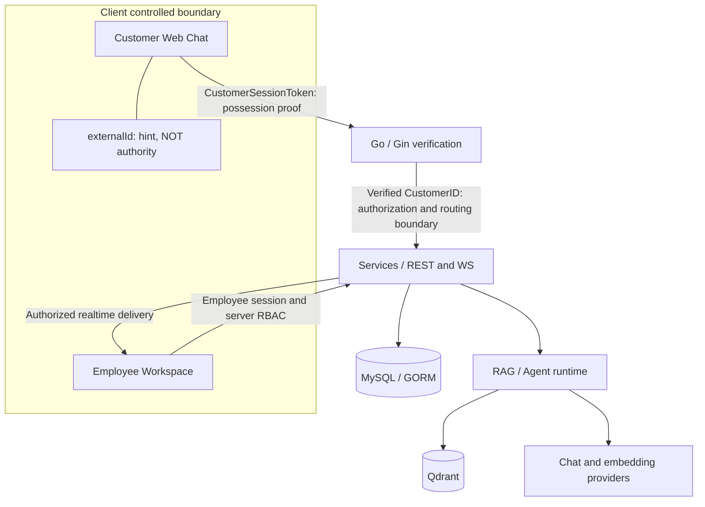

# KestrelDesk architecture

## Product scope

KestrelDesk provides an AI helpdesk with customer Web chat, an employee workspace, knowledge indexing and retrieval, the Answerability Gate, tickets, handoff, teams and schedules, Skills/MCP integrations, and an embeddable Web SDK. Its security boundaries cover provider tool compatibility, customer identity scope, employee realtime authorization, and socket lifecycle.

## Components

| Layer | Current implementation | Responsibility |
| --- | --- | --- |
| Go server | Go 1.26, Gin, GORM, `github.com/mlogclub/simple` | Explicit routes, middleware, services, repositories |
| Relational data | MySQL is the default in the Compose demo; SQLite is supported. PostgreSQL is also available as a configured GORM driver in code. | Customers, conversations, employees, login sessions, RBAC and knowledge metadata |
| Vector storage | Qdrant in the local demo | Knowledge chunk embeddings and filtered retrieval |
| Chat | DeepSeek-compatible provider in the local demo | Responses grounded in retrieved evidence |
| Embeddings | BAAI/bge-m3 in the local demo | Query/document vectors; deployment configuration selects the provider |
| Frontend | Next.js 16 / React 19 / TypeScript | Employee dashboard/workbench and customer/support pages |
| Editor / SDK | Flowgram editor and Web SDK | Workflow authoring and customer embedding surfaces |

Model names describe the verified local setup, not mandatory defaults or bundled model weights. Provider credentials remain in private deployment configuration.

## Trust boundaries

The guest exchange treats externalId as an untrusted hint. A valid server-signed CustomerSessionToken provides possession proof; its verified CustomerID determines authorization. Employee REST permissions and realtime permissions are server owned. Socket activation, delivery deadlines and revocation are tied to employee login sessions; authenticating a handshake does not authorize a connection indefinitely.

## Code map

- [Assembly](../../internal/bootstrap/server.go) and [explicit routes](../../internal/bootstrap/routes.go): REST under `/api/*` and `/api/dashboard/*`, WebSockets under `/api/ws/*`.
- [Customer session service](../../internal/services/customer_session_service.go): exchange, verification and binding.
- [Customer lookup](../../internal/repositories/customer_session_lookup.go): primary-key lookup; [identity lookup](../../internal/repositories/customer_identity_lookup.go): exact customer/source/external identity association.
- [Realtime service](../../internal/services/ws_service.go) and [session manager](../../internal/services/ws_connection_manager.go): subscriptions, routing, terminal close and delivery.
- [Login sessions](../../internal/services/login_session_service.go): persisted employee session lifecycle.
- [Customer scope](../../web/lib/api/im-session-scope.ts): CustomerID/channel identity epoch and attempt generation; departed callbacks cannot mutate current customer state.
- [RAG](../../internal/ai/rag/) and [runtime retriever](../../internal/ai/runtime/retrievers/knowledge_retriever.go): evidence assembly.
- [Provider aliases](../../internal/ai/application/runtime/eino_agent_loop.go): deterministic safe names mapped back to complete internal tool identities.

The Go layer order is models → repositories → services → handlers/DTO builders. Services own transactions; repositories operate on the supplied GORM database/transaction. Frontend scopes isolate callbacks but do not grant server authorization.

## Boundaries of the acceptance

This is a local engineering demonstration, not a production capacity or complete security certification. Attachment AssetID/direct URL authorization is **DEFERRED**. Human handoff is **PARTIAL** in the accepted demo record. Normal concurrency tests pass; the Windows race runtime is environment-blocked. See [guest security](guest-identity-security.md), [realtime authorization](realtime-authorization.md), [socket lifecycle](websocket-lifecycle.md) and [RAG](rag-pipeline.md).

> This file has been modified for the KestrelDesk project.
